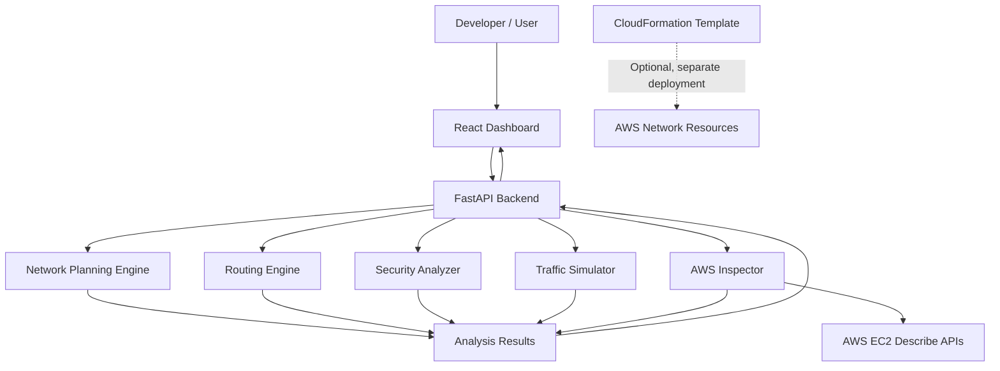

<div align="center">

# ☁️ CLOUDGUARD

### Secure AWS Network Architect

**Design. Analyze. Secure.**


-FF9900?logo=amazonaws&logoColor=white)


</div>

CLOUDGUARD is a security-focused AWS network architecture and analysis project. It helps developers and cloud engineers plan IPv4 network layouts, evaluate simplified routing, analyze security-group rules, simulate traffic flows, and inspect selected AWS VPC resources through read-only EC2 `Describe` calls, all from a React dashboard backed by a FastAPI service.

> [!IMPORTANT]
> CLOUDGUARD is a development and learning project. Its results are **rule-based indicators from simplified models**. They are not a guarantee of AWS security or real network reachability, and findings need manual review before any infrastructure decision. AWS inspection is read-only, but the included CloudFormation template **can create real, billable AWS resources if deployed**.

## Table of Contents

- [Key Features](#key-features)
- [Architecture](#architecture)
- [Technology Stack](#technology-stack)
- [Project Structure](#project-structure)
- [Prerequisites](#prerequisites)
- [Getting Started](#getting-started)
- [Running the Application](#running-the-application)
- [Testing and Production Build](#testing-and-production-build)
- [AWS Inspection](#aws-inspection)
- [CloudFormation Infrastructure](#cloudformation-infrastructure)
- [Security Considerations](#security-considerations)
- [Current Limitations](#current-limitations)
- [Documentation](#documentation)
- [Roadmap](#roadmap)
- [Contributing](#contributing)
- [License](#license)

## Key Features

| | Capability | What it does | Touches AWS? |
|---|---|---|---|
| 🧮 | **Network planning** | Validates IPv4 CIDRs and plans subnet allocations locally | No |
| 🛣️ | **Routing analysis** | Simplified route-selection logic for understanding paths | No |
| 🛡️ | **Security rule analysis** | Flags risky security-group rules using predefined checks | No |
| 🚦 | **Traffic simulation** | Models a flow through route, outbound, and inbound rules | No |
| 🔍 | **AWS VPC inspection** | Read-only EC2 `Describe` inspection of selected VPC resources | Yes (read-only) |
| 📊 | **Dashboard** | React UI over the backend API | Via the API |

<details>
<summary><strong>Security analyzer detection rules</strong></summary>

| Finding | Severity |
|---|---|
| Ingress allowing all traffic from a public source | Critical |
| Ingress allowing all ports from a public source | Critical |
| Public database access on recognized database ports | Critical |
| Public SSH access | High |
| Public RDP access | High |
| Unrestricted egress | Medium |

These are rule-based indicators. They highlight configurations worth investigating but do not establish exploitability or complete exposure.

</details>

<details>
<summary><strong>AWS inspection scope</strong></summary>

The inspector reads selected networking information: VPC configuration, subnets, route tables, internet gateways, and security groups. It identifies selected patterns, such as IPv4/IPv6 default routes and potentially risky security-group rules, where its implemented checks support them.

**Inspection is not remediation.** The service does not modify inspected AWS resources.

</details>

The backend also includes automated tests for the health endpoint and the planning, routing, security-analysis, traffic-simulation, and AWS-inspection components.

## Architecture



Local analysis is separate from AWS inspection. The CloudFormation template is an independent infrastructure definition; deploying it is an explicit, optional step and is not needed to run the application locally. More detail: [Architecture](docs/ARCHITECTURE.md).

## Technology Stack

| Area | Technologies |
|---|---|
| Frontend | React, Vite, JavaScript, CSS |
| Backend | Python, FastAPI, Uvicorn |
| Validation and models | Pydantic |
| AWS integration | Boto3, AWS EC2 APIs |
| Infrastructure as code | AWS CloudFormation |
| Testing | Pytest, HTTPX |
| Development tools | Git, npm, Python virtual environments |

## Project Structure

<details>
<summary><strong>Show repository tree</strong></summary>

```text
CLOUDGUARD/
├── backend/
│   ├── app/
│   │   ├── api/
│   │   ├── core/
│   │   ├── models/
│   │   ├── rules/
│   │   ├── services/
│   │   │   ├── aws_inspector.py
│   │   │   ├── network_engine.py
│   │   │   ├── routing_engine.py
│   │   │   ├── security_analyzer.py
│   │   │   └── traffic_simulator.py
│   │   └── main.py
│   ├── tests/
│   └── requirements.txt
├── docs/
│   ├── API_REFERENCE.md
│   ├── ARCHITECTURE.md
│   ├── DEPLOYMENT_GUIDE.md
│   ├── PROJECT_OVERVIEW.md
│   └── SECURITY_MODEL.md
├── examples/
├── frontend/
│   ├── src/
│   │   ├── App.jsx
│   │   ├── main.jsx
│   │   └── styles.css
│   ├── index.html
│   ├── package.json
│   └── vite.config.js
├── infrastructure/
│   └── cloudformation/
│       └── cloudguard-network.yaml
├── scripts/
└── .gitignore
```

The tree shows the main known files; others may exist.

</details>

## Prerequisites

- **Python 3.12** (current development environment).
- **Node.js and npm** for the frontend.
- **Git**.
- **AWS CLI**, only for AWS inspection or CloudFormation workflows.
- An AWS account and appropriately authorized credentials, only if you intend to connect to AWS.

Docker is not required for the documented local Python and Vite workflow. The commands below are for **Windows PowerShell**.

## Getting Started

**1. Clone the repository** (replace the placeholder; skip if you already have the project):

```powershell
git clone <YOUR-REPOSITORY-URL>
cd CLOUDGUARD
```

**2. Set up the backend:**

```powershell
cd backend
python -m venv .venv
.\.venv\Scripts\Activate.ps1
python -m pip install --upgrade pip
pip install -r requirements.txt
```

> [!TIP]
> If PowerShell blocks activation, call the interpreter inside `.venv` directly or follow your organization's approved execution-policy guidance. Avoid weakening system security settings unnecessarily.

**3. Set up the frontend** in a **second PowerShell terminal**, from the project root:

```powershell
cd frontend
npm ci
```

`npm ci` installs the exact dependency versions recorded in the committed lockfile.

## Running the Application

Run the backend and frontend in **separate terminals**.

**Terminal 1: backend** (from `backend/`, virtual environment activated):

```powershell
python -m uvicorn app.main:app --reload --port 8001
```

| Resource | URL |
|---|---|
| Application | `http://127.0.0.1:8001` |
| Interactive API docs (Swagger UI) | `http://127.0.0.1:8001/docs` |
| OpenAPI schema | `http://127.0.0.1:8001/openapi.json` |

**Terminal 2: frontend** (from the project root):

```powershell
cd frontend
npm run dev
```

Open the URL Vite prints in the terminal (commonly `http://localhost:5173`).

<details>
<summary><strong>Troubleshooting: frontend cannot reach the backend</strong></summary>

- Confirm both servers are running.
- Confirm the backend is on port `8001`.
- Review the frontend API configuration and the proxy settings in [`frontend/vite.config.js`](frontend/vite.config.js); the configured backend port must match.
- See the [Deployment Guide](docs/DEPLOYMENT_GUIDE.md) for more setup and troubleshooting notes.

</details>

## Testing and Production Build

**Backend tests** (from the project root):

```powershell
cd backend
.\.venv\Scripts\Activate.ps1
python -m pytest -v
```

Passing tests do not guarantee coverage of every AWS configuration, network path, or security scenario.

**Frontend production build** (from the project root):

```powershell
cd frontend
npm ci
npm run build
```

Vite writes static output to `frontend/dist/`. This does not deploy the application anywhere.

## AWS Inspection

The inspector queries selected properties of an **existing** VPC using read-only EC2 `Describe` operations.

```powershell
aws --version                  # confirm AWS CLI is installed
aws configure list-profiles    # list configured profiles
aws configure list             # show the active credentials and region
aws sts get-caller-identity    # show which identity the CLI will use
```

`get-caller-identity` shows the active identity; it does not prove that identity has every permission the inspector needs.

- Use a region appropriate to your resources (the current development environment uses `ap-south-1`).
- With the default profile, omit `--profile`; otherwise pass it explicitly or set `AWS_PROFILE` for the current PowerShell session.
- Never commit access keys, secret keys, session tokens, or private environment files.

> [!NOTE]
> The inspector does not comprehensively assess network ACLs, IAM policies, workload configuration, application health, every routing component, or end-to-end reachability. Treat findings as investigation leads, not a security certification. See the [Security Model](docs/SECURITY_MODEL.md).

## CloudFormation Infrastructure

Template: [`infrastructure/cloudformation/cloudguard-network.yaml`](infrastructure/cloudformation/cloudguard-network.yaml)

It defines a sample network environment:

- One VPC using `10.0.0.0/16`.
- Two public-designated and two private-designated subnets.
- An internet gateway and a public route table.
- Private route tables without a default internet route.
- A security group with no inbound rules and TCP 443 egress.

Subnets disable automatic public IPv4 assignment. A subnet's name or designation alone does not establish that workloads are reachable from the internet, and a private subnet without a default route has no outbound internet access.

**Validate the template** (from the project root):

```powershell
aws cloudformation validate-template --template-body file://infrastructure/cloudformation/cloudguard-network.yaml --region ap-south-1
```

> [!NOTE]
> Validation only checks that CloudFormation can parse the template. It does **not** deploy anything or guarantee a deployment will succeed in your account.

> [!WARNING]
> **Deploying the template can create real AWS resources and may incur charges.** Review the full template and expected changes, and confirm the account, region, permissions, and costs first. Do not deploy just to run the local dashboard. Nothing in this repository implies resources have already been deployed.

<details>
<summary><strong>Cleanup guidance</strong></summary>

If you deploy a stack for testing, identify the exact stack and its resources before deleting it. Deletion can remove infrastructure and associated resources, so check retention settings and any data you need to keep first. See the [Deployment Guide](docs/DEPLOYMENT_GUIDE.md) for the project's workflow and safety notes.

</details>

## Security Considerations

- Give AWS inspection credentials only the read-only `Describe` permissions it needs.
- Keep credentials out of source code, frontend bundles, logs, screenshots, and Git history.
- Treat public SSH, RDP, and database findings as high-priority review items.
- Validate assumptions against the real AWS environment; simulated outcomes are not proof of reachability.
- Review the CloudFormation template and its potential costs before any deployment.
- The [Security Model](docs/SECURITY_MODEL.md) documents the implemented rules and their limits.

## Current Limitations

CLOUDGUARD is an engineering and learning project, not a replacement for AWS security services or a production cloud security platform.

- Network planning is limited to local IPv4 calculations.
- Routing and traffic simulation use simplified models.
- Security analysis covers only implemented rule patterns. The local analyzer does not model IPv6 rules, prefix lists, or security-group references.
- AWS inspection covers selected VPC networking resources and does not prove end-to-end reachability.
- Findings require human review and may lack the full context of a deployed environment.
- CloudFormation validation does not mean resources are deployed or that an AWS account is correctly configured.

## Documentation

| Document | Purpose |
|---|---|
| [Project Overview](docs/PROJECT_OVERVIEW.md) | Scope, objectives, and status |
| [Architecture](docs/ARCHITECTURE.md) | Components and data flow |
| [API Reference](docs/API_REFERENCE.md) | Endpoints and payloads |
| [Security Model](docs/SECURITY_MODEL.md) | Detection rules, permissions, limits |
| [Deployment Guide](docs/DEPLOYMENT_GUIDE.md) | Setup, AWS access, and deployment notes |

## Roadmap

Potential improvements (not implemented features):

- Broader network-analysis coverage and edge-case tests.
- More comprehensive security-group and IPv6 analysis.
- Clearer explanations and traceability for findings.
- Integration tests against controlled AWS test environments.
- Better error handling and observability.
- Automated infrastructure-template linting.
- Improved deployment validation and reproducible setup.

## Contributing

Contributions, bug reports, and suggestions are welcome.

1. Fork the repository and create a feature branch.
2. Make focused changes and add or update tests where appropriate.
3. Run the backend tests and the frontend production build.
4. Open a pull request describing the change, validation performed, and any security implications.

Never include credentials, private account details, or real infrastructure secrets in issues, fixtures, or pull requests.

## License

No license is asserted in this README. Check for a `LICENSE` file in the repository before redistributing or reusing the project.

---

<div align="center">

**CLOUDGUARD — Secure AWS Network Architect**

*Plan networks. Analyze security. Understand infrastructure.*

</div>
