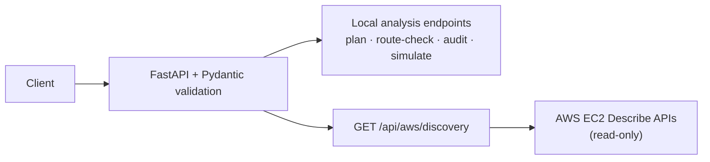

# CLOUDGUARD — API Reference

> **Secure AWS Network Architect** · HTTP API reference for the CLOUDGUARD backend.

CLOUDGUARD's backend exposes JSON endpoints for IPv4 network planning, simplified route evaluation, security group rule analysis, traffic simulation, and read-only AWS VPC discovery.

| Item | Value |
|---|---|
| Backend stack | Python, FastAPI, Pydantic, Uvicorn, Boto3 (AWS discovery) |
| Entry point | `backend/app/main.py` |
| Development base URL | `http://127.0.0.1:8001` |
| Content type | JSON |

> [!NOTE]
> The base URL is for **local development only**. It is not a public or production endpoint.

> [!IMPORTANT]
> **Documentation status.** This document was written from the project's `ARCHITECTURE.md`. The backend source files (`main.py`, request models, services, tests) were **not supplied**. Only confirmed details are stated. Items marked **`VERIFY`** must be checked against the source before release. No field names, status codes, or response schemas have been invented.

## Table of Contents

1. [API Overview](#1-api-overview)
2. [Endpoint Summary](#2-endpoint-summary)
3. [Endpoint Reference](#3-endpoint-reference)
   - [3.1 GET /](#31-get-)
   - [3.2 GET /health](#32-get-health)
   - [3.3 POST /api/network/plan](#33-post-apinetworkplan)
   - [3.4 POST /api/network/route-check](#34-post-apinetworkroute-check)
   - [3.5 POST /api/security/audit](#35-post-apisecurityaudit)
   - [3.6 POST /api/traffic/simulate](#36-post-apitrafficsimulate)
   - [3.7 GET /api/aws/discovery](#37-get-apiawsdiscovery)
4. [Validation and Error Handling](#4-validation-and-error-handling)
5. [Interactive API Exploration](#5-interactive-api-exploration)
6. [Safe Local Usage](#6-safe-local-usage)
7. [Security and Limitations](#7-security-and-limitations)
8. [API Verification Checklist](#8-api-verification-checklist)

## 1. API Overview

- **FastAPI** exposes the HTTP endpoints and generates interactive documentation.
- **Pydantic** request models validate payloads; services perform additional domain checks (CIDR, IP, protocol, port validation).
- **JSON** is used for requests and responses.
- **Local analysis vs. live AWS:** only `GET /api/aws/discovery` contacts AWS. The other analytical endpoints operate on supplied data and do not require AWS access.



## 2. Endpoint Summary

| Method | Path | Purpose | AWS access |
|---|---|---|---|
| GET | [`/`](#31-get-) | API identity and operational information | No |
| GET | [`/health`](#32-get-health) | Health check | No |
| POST | [`/api/network/plan`](#33-post-apinetworkplan) | Generate an IPv4 subnet plan | No |
| POST | [`/api/network/route-check`](#34-post-apinetworkroute-check) | Evaluate a destination against supplied routes | No |
| POST | [`/api/security/audit`](#35-post-apisecurityaudit) | Analyze supplied security group rules | No |
| POST | [`/api/traffic/simulate`](#36-post-apitrafficsimulate) | Simulate a selected traffic flow | No |
| GET | [`/api/aws/discovery`](#37-get-apiawsdiscovery) | Read-only discovery of a specified VPC | Yes (read-only) |

## 3. Endpoint Reference

### 3.1 GET /

Returns API identity and operational information.

- **Request:** none.
- **Response fields:** `VERIFY` against `main.py`.
- **Status codes:** `VERIFY`.

### 3.2 GET /health

Backend health check.

- **Request:** none.
- **Response fields:** `VERIFY` against `main.py`.
- **Status codes:** `VERIFY`.

> [!NOTE]
> A successful health response should not be read as proof of AWS connectivity or of any dependency's health unless the code explicitly checks those things (`VERIFY`).

### 3.3 POST /api/network/plan

Generates an IPv4 subnet plan. Service: `backend/app/services/network_engine.py`.

**Request body** (field names, types, defaults, and constraints: `VERIFY` against the Pydantic model):

| Input | Confirmed behaviour |
|---|---|
| VPC CIDR | Validated as an IPv4 CIDR |
| VPC / subnet prefix size | Requested sizes are checked |
| Public subnet count | Validated |
| Private subnet count | Validated |

**Behaviour (confirmed):**

- Public subnet entries are allocated before private entries.
- Subnet CIDRs are allocated; address capacity and remaining capacity are calculated.
- Returns a structured network plan (response schema: `VERIFY`).

**Limitations:** IPv4 only. Subnet labels describe the proposed plan, not verified AWS reachability.

**Errors:** domain validation errors are returned as client errors where handled by the endpoint. Exact status codes and messages: `VERIFY`.

### 3.4 POST /api/network/route-check

Evaluates a destination against supplied routes. Service: `backend/app/services/routing_engine.py`.

**Request body** (field names, route-entry fields, constraints: `VERIFY`):

| Input | Confirmed behaviour |
|---|---|
| VPC CIDR | Validated |
| Destination IP | Validated |
| Supplied routes | Used for external destinations |

**Behaviour (confirmed):**

- A destination inside the VPC CIDR is treated as **local**.
- For external destinations, **longest-prefix-match** is applied to the supplied routes.
- Returns a simplified routing decision and explanation (response schema: `VERIFY`).

> [!WARNING]
> The result is an educational model of routing, **not** proof of real AWS reachability. It does not reproduce all AWS routing, propagation, or appliance behaviour.

### 3.5 POST /api/security/audit

Analyzes supplied security group rules. Service: `backend/app/services/security_analyzer.py`.

**Request body** (rule schema, field names, allowed protocol values, port constraints: `VERIFY`):

| Input | Confirmed behaviour |
|---|---|
| Protocol | Must be a supported protocol |
| CIDR | Validated as IPv4 |
| TCP/UDP ports | Port ranges validated |

**Behaviour (confirmed):**

- Identifies selected potentially risky inbound rules and selected broad outbound rules.
- Returns findings with a severity and explanatory identifiers (exact severity levels and finding schema: `VERIFY`).

> [!WARNING]
> Findings are rule-based. They do **not** prove exploitability, and the analyzer evaluates only the rules supplied to it, not an account's effective permissions.

### 3.6 POST /api/traffic/simulate

Simulates a selected traffic flow. Service: `backend/app/services/traffic_simulator.py`.

**Request body** (field names, defaults, validation: `VERIFY`): a proposed source and destination, plus the supplied routing configuration and security rules.

**Evaluation order (confirmed):**

1. Evaluate the supplied routing configuration.
2. Check the applicable outbound rule.
3. Check the applicable inbound rule.

Returns a simplified allow/block decision and explanation (response schema: `VERIFY`).

**Limitations:** does not model every AWS security group stateful behaviour, network ACLs, firewalls, operating-system firewalls, application listeners, or service availability.

### 3.7 GET /api/aws/discovery

Performs read-only discovery of a specified AWS VPC. Service: `backend/app/services/aws_inspector.py`.

**Query parameters** (exact names, defaults, identifier format rules: `VERIFY`):

| Input | Confirmed behaviour |
|---|---|
| VPC identifier | Validated |
| AWS region | Validated |

**Behaviour (confirmed):**

- Obtains an EC2 client via the configured Boto3 credential-provider chain.
- Calls selected EC2 Describe operations: VPC details and tags, subnets, route tables, internet gateway attachments, security group permissions.
- Generates selected rule-based findings.
- Returns inventory, summary information, findings, and limitations (response schema: `VERIFY`).

**Distinguished failure cases (confirmed categories; status-code mapping: `VERIFY`):**

| Case | Notes |
|---|---|
| Invalid parameters | Client error |
| Access denied | AWS permissions failure |
| Resource not found | Requested VPC does not exist |
| Upstream / service error | AWS or API failure |

> [!WARNING]
> Access-denied, not-found, and upstream errors are failures, not evidence that an environment is secure. Success depends on valid credentials, IAM permissions, network access to AWS, and the VPC existing.

## 4. Validation and Error Handling

| Category | Where | Status code |
|---|---|---|
| Request-model validation failure | Pydantic / FastAPI | `VERIFY` (FastAPI's default is typically `422`) |
| Domain validation (CIDR, IP, protocol, port) | Services / endpoints | `VERIFY` (client error) |
| Unsupported or unmatched routing scenario | Routing engine | `VERIFY` |
| AWS access denied | `/api/aws/discovery` | `VERIFY` |
| AWS resource not found | `/api/aws/discovery` | `VERIFY` |
| AWS / upstream service error | `/api/aws/discovery` | `VERIFY` |

No universal error response format is documented here; confirm the actual error body shape in the source.

## 5. Interactive API Exploration

Local development resources only:

- Swagger UI: [http://127.0.0.1:8001/docs](http://127.0.0.1:8001/docs)
- OpenAPI schema: [http://127.0.0.1:8001/openapi.json](http://127.0.0.1:8001/openapi.json)

The OpenAPI schema is generated by FastAPI and is the best source for confirming field names, types, and constraints for the `VERIFY` items above.

## 6. Safe Local Usage

Local ports: backend `8001`, frontend `5173`. The commands below are templates; the virtual-environment path and module path must be confirmed (`VERIFY`).

```powershell
Set-Location "$HOME\Desktop\CLOUDGUARD\backend"
.\.venv\Scripts\Activate.ps1
uvicorn app.main:app --host 127.0.0.1 --port 8001
```

Check the running backend:

```powershell
Invoke-RestMethod http://127.0.0.1:8001/health
```

> [!IMPORTANT]
> AWS discovery requires credentials configured separately through the standard Boto3 credential-provider chain. Never place credentials in source files or documentation. Local analysis endpoints do not need AWS credentials.

## 7. Security and Limitations

- **Input validation:** Pydantic models plus service-level checks for CIDRs, IPs, protocols, and ports.
- **Read-only discovery:** AWS access is limited to selected EC2 Describe operations; the API does not deploy, modify, or delete AWS resources.
- **Least-privilege IAM:** grant only the Describe permissions the inspector requires.
- **No secrets in source control:** keep credentials and sensitive local configuration untracked.
- **Simplified IPv4 analysis:** no full IPv6, network ACL, or firewall evaluation.
- **Analysis ≠ reachability:** a successful response means the operation completed per application logic. It does not guarantee real workload reachability or that a configuration is safe.

## 8. API Verification Checklist

- [ ] Every endpoint above matches `backend/app/main.py`.
- [ ] All `VERIFY` items resolved from source, models, and tests.
- [ ] Request and response schemas match the implementation (confirm via `/openapi.json`).
- [ ] JSON examples added from real requests and validated.
- [ ] Error status codes and bodies confirmed.
- [ ] Endpoints tested locally.
- [ ] Backend tests pass.
- [ ] No credentials, account IDs, or real resource IDs are present or tracked.

[↑ Back to top](#cloudguard--api-reference)
