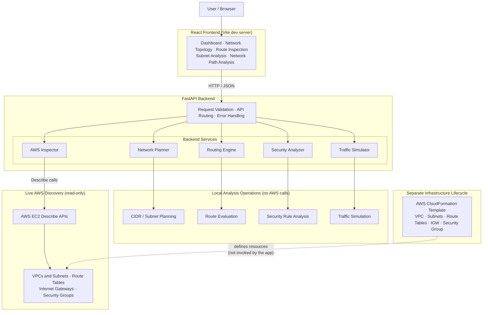
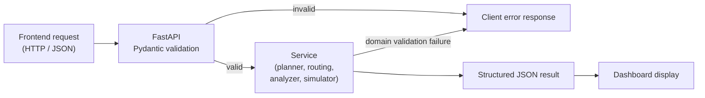
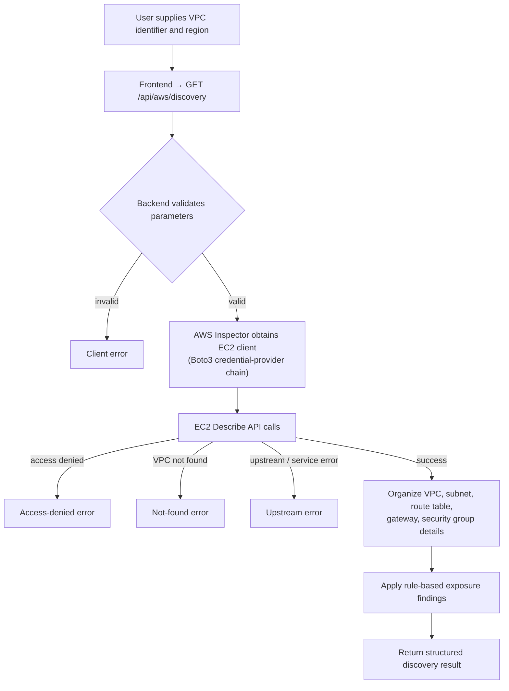
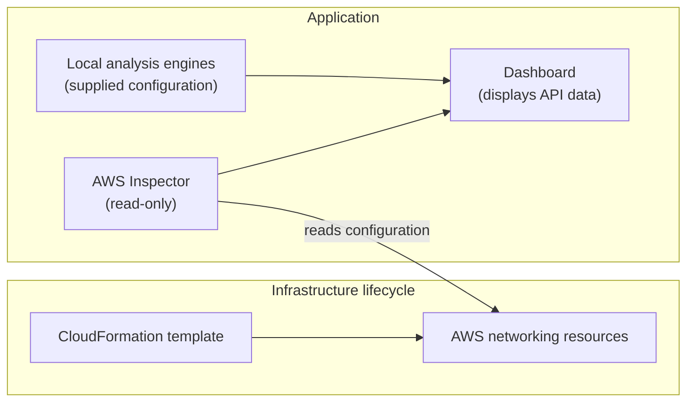

# CLOUDGUARD — System Architecture

> **Secure AWS Network Architect** · High-level architecture of the frontend, backend API, analysis services, AWS discovery integration, and infrastructure definition.

> [!NOTE]
> This document distinguishes **local analytical operations** from **live AWS discovery**. Not every dashboard operation communicates with AWS.

## Table of Contents

1. [Document Overview](#1-document-overview)
2. [System Architecture](#2-system-architecture)
3. [Component and Responsibility Matrix](#3-component-and-responsibility-matrix)
4. [Frontend Architecture](#4-frontend-architecture)
5. [Backend API Architecture](#5-backend-api-architecture)
6. [API Reference](#6-api-reference)
7. [Backend Service Architecture](#7-backend-service-architecture)
   - [7.1 Network Planning Engine](#71-network-planning-engine)
   - [7.2 Routing Engine](#72-routing-engine)
   - [7.3 Security Analyzer](#73-security-analyzer)
   - [7.4 Traffic Simulator](#74-traffic-simulator)
   - [7.5 AWS Inspector](#75-aws-inspector)
8. [Local Analysis Request Flow](#8-local-analysis-request-flow)
9. [AWS Discovery Data Flow](#9-aws-discovery-data-flow)
10. [Infrastructure and CloudFormation](#10-infrastructure-and-cloudformation)
11. [Local Development Environment](#11-local-development-environment)
12. [Error Handling and Trust Boundaries](#12-error-handling-and-trust-boundaries)
13. [Known Limitations](#13-known-limitations)
14. [Verification Checklist](#14-verification-checklist)
15. [Maintenance and Evolution](#15-maintenance-and-evolution)

## 1. Document Overview

This document describes the current high-level architecture of CLOUDGUARD: the frontend, backend API, analysis services, AWS discovery integration, infrastructure definition, and the main data flows between them.

The code and infrastructure template remain the sources of truth for implementation details.

## 2. System Architecture

CLOUDGUARD uses a modular frontend/backend architecture. The diagram shows logical responsibilities, not deployment topology.

## 3. Component and Responsibility Matrix

| Layer | Purpose | Technology | Location |
|---|---|---|---|
| Frontend | Explore network and security information | React, Vite, JavaScript, CSS | Not specified in source |
| Backend API | Endpoints, validation, JSON responses | Python, FastAPI, Pydantic, Uvicorn | `backend/app/main.py` |
| Network Planner | IPv4 subnet planning | Python | `backend/app/services/network_engine.py` |
| Routing Engine | Simplified route decision | Python | `backend/app/services/routing_engine.py` |
| Security Analyzer | Security group rule findings | Python | `backend/app/services/security_analyzer.py` |
| Traffic Simulator | Simplified allow/block simulation | Python | `backend/app/services/traffic_simulator.py` |
| AWS Inspector | Read-only VPC discovery | Python, Boto3, EC2 Describe APIs | `backend/app/services/aws_inspector.py` |
| Infrastructure | AWS networking lab definition | AWS CloudFormation | `infrastructure/cloudformation/cloudguard-network.yaml` |

## 4. Frontend Architecture

**Technologies:** React, Vite, JavaScript, CSS.

The frontend provides the interface for exploring network and security information. It sends requests to the backend API and presents returned data in dashboard components.

**Implemented capabilities:**

- Network topology exploration
- Subnet selection and inspection
- Route table inspection
- Gateway target inspection
- Subnet exposure indicators
- Network path analysis

> [!NOTE]
> An indicator based on a route table or subnet setting is not, by itself, proof of end-to-end connectivity.

**Development request flow:** Vite serves the frontend. Requests under `/api` are configured to use the backend on port `8001`.

## 5. Backend API Architecture

**Technologies:** Python, FastAPI, Pydantic, Uvicorn.
**Entry point:** `backend/app/main.py`

FastAPI exposes HTTP endpoints, validates request payloads, invokes the appropriate service, and returns JSON. Input is validated through request models and service-level checks. Domain validation errors are returned as client errors where handled by the endpoint; AWS discovery also distinguishes selected not-found, access-denied, and upstream/service error cases.

## 6. API Reference

| Method | Endpoint | Responsibility | Service |
|---|---|---|---|
| GET | `/` | API identity and operational information | — |
| GET | `/health` | Health check | — |
| POST | `/api/network/plan` | Generate an IPv4 subnet plan | [Network Planner](#71-network-planning-engine) |
| POST | `/api/network/route-check` | Evaluate a destination against supplied routes | [Routing Engine](#72-routing-engine) |
| POST | `/api/security/audit` | Analyze supplied security group rules | [Security Analyzer](#73-security-analyzer) |
| POST | `/api/traffic/simulate` | Simulate a selected network traffic flow | [Traffic Simulator](#74-traffic-simulator) |
| GET | `/api/aws/discovery` | Read-only discovery of a specified AWS VPC | [AWS Inspector](#75-aws-inspector) |

**Local development documentation (not production URLs):**

- Interactive API docs: [http://127.0.0.1:8001/docs](http://127.0.0.1:8001/docs)
- OpenAPI schema: [http://127.0.0.1:8001/openapi.json](http://127.0.0.1:8001/openapi.json)

## 7. Backend Service Architecture

Services are located under `backend/app/services/`.

### 7.1 Network Planning Engine

**File:** `network_engine.py`

| Aspect | Description |
|---|---|
| Responsibility | Plan IPv4 subnets within a VPC CIDR |
| Processing | Validate IPv4 CIDR inputs; check requested VPC and subnet prefix sizes; validate public and private subnet counts; allocate subnet CIDRs (public entries before private); calculate address capacity and remaining capacity |
| Output | Structured network plan |
| Limitation | Subnet labels describe the proposed plan, not a verified AWS reachability result |

### 7.2 Routing Engine

**File:** `routing_engine.py`

| Aspect | Description |
|---|---|
| Responsibility | Simplified routing decision for a destination |
| Processing | Validate VPC CIDR and destination IP; treat destinations inside the VPC CIDR as local; apply longest-prefix-match to supplied routes for external destinations |
| Output | Routing decision and explanation |
| Limitation | Educational model; does not reproduce all AWS routing, propagation, appliance, or reachability behaviour |

### 7.3 Security Analyzer

**File:** `security_analyzer.py`

| Aspect | Description |
|---|---|
| Responsibility | Evaluate supplied security group rules |
| Processing | Validate supported protocols and IPv4 CIDRs; validate TCP/UDP port ranges; identify selected potentially risky inbound rules and selected broad outbound rules |
| Output | Findings with severity and explanatory identifiers |
| Limitation | Evaluates only supplied rules; does not retrieve an account's effective permissions or prove exploitability |

### 7.4 Traffic Simulator

**File:** `traffic_simulator.py`

| Aspect | Description |
|---|---|
| Responsibility | Simulate a proposed source-to-destination flow |
| Processing | Evaluate supplied routing configuration; check the applicable outbound rule; check the applicable inbound rule |
| Output | Simplified allow/block decision and explanation |
| Limitation | Does not model every AWS security group stateful behaviour, network ACL, firewall, operating-system firewall, application listener, or service-availability condition |

### 7.5 AWS Inspector

**File:** `aws_inspector.py`

| Aspect | Description |
|---|---|
| Responsibility | Read-only discovery of a live VPC |
| Processing | Validate VPC identifier and region; use selected EC2 Describe operations; inspect VPC details and tags; retrieve subnets and route tables; inspect internet gateway attachments; retrieve security group permissions; generate selected rule-based findings |
| Output | Inventory, summary information, findings, and limitations |
| Limitation | Depends on credentials and IAM permissions; restrict permissions to the operations the application requires |

> [!IMPORTANT]
> AWS discovery is intended to be read-only.

## 8. Local Analysis Request Flow

Local analysis operates on supplied configuration data and does not call AWS.

## 9. AWS Discovery Data Flow

Discovery depends on valid AWS credentials, appropriate IAM permissions, network access to AWS APIs, and the existence of the requested VPC.

> [!WARNING]
> Access denied, missing resources, and upstream errors are failures. They must not be interpreted as proof that the environment is secure.

## 10. Infrastructure and CloudFormation

**Template:** `infrastructure/cloudformation/cloudguard-network.yaml`

The template describes the AWS networking lab resources: VPC, subnets, route tables, internet gateway, security group, and associated networking resources.

> [!IMPORTANT]
> The existence of a CloudFormation template does not mean the application deploys, updates, or deletes AWS resources. Infrastructure changes should be reviewed separately, with explicit approval, before execution.

## 11. Local Development Environment

| Component | Local address | Purpose |
|---|---|---|
| Frontend | `http://127.0.0.1:5173/` | Dashboard |
| Backend | `http://127.0.0.1:8001/` | API root |
| Health check | `http://127.0.0.1:8001/health` | Backend health |
| API documentation | `http://127.0.0.1:8001/docs` | Interactive API documentation |
| OpenAPI schema | `http://127.0.0.1:8001/openapi.json` | API schema |

> [!NOTE]
> These are local development addresses, not production deployment URLs.

## 12. Error Handling and Trust Boundaries

**Failure categories handled:**

- Invalid user input
- Invalid CIDR ranges, IP addresses, protocols, or ports
- Unsupported or unmatched routing scenarios
- AWS access-denied errors
- AWS resources that cannot be found
- AWS or upstream service errors

**Trust boundaries:**

- A successful API response means the operation completed according to the application's logic. It does not guarantee that a real workload is reachable, that a configuration is safe, or that the environment has no additional risks.
- AWS responses and user-provided configuration are treated as input data.
- Findings should be interpreted with the surrounding infrastructure and operational context.

## 13. Known Limitations

| Distinction | Meaning |
|---|---|
| Rule-based finding ≠ confirmed vulnerability | Findings are pattern-based and do not prove exploitability |
| Route decision ≠ end-to-end reachability | Routing results are simplified and educational |
| Read-only discovery ≠ infrastructure mutation | The application does not deploy or modify AWS resources |
| Local simulation ≠ AWS network behaviour | Simulation omits many real-world controls |

The current architecture does **not** claim to provide:

- A complete AWS account-wide security audit
- Full IPv6 network analysis
- Full network ACL or firewall evaluation
- Guaranteed end-to-end reachability verification
- Automatic remediation of AWS resources
- Comprehensive application-layer security testing
- Production-grade monitoring of all AWS networking changes

These capabilities would require additional implementation, permissions, testing, and explicit design decisions.

## 14. Verification Checklist

Before a release, verify that:

- [ ] Frontend dependencies install from the committed lockfile.
- [ ] The frontend production build completes successfully.
- [ ] Backend dependencies install in a clean virtual environment.
- [ ] Backend tests pass.
- [ ] API routes and response schemas match the implementation.
- [ ] AWS discovery handles missing permissions and missing resources.
- [ ] No AWS credentials or sensitive local configuration are tracked.
- [ ] The CloudFormation template passes appropriate validation.
- [ ] Documentation matches the tested code and infrastructure template.
- [ ] No infrastructure changes are made without explicit approval.

## 15. Maintenance and Evolution

Update this document when API endpoints, backend service responsibilities, frontend data flows, AWS discovery permissions, or infrastructure definitions change.

The code and infrastructure template remain the sources of truth for implementation details.

[↑ Back to top](#cloudguard--system-architecture)
