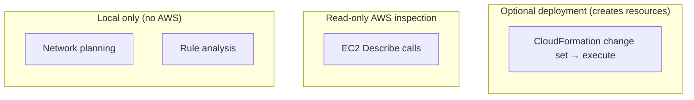
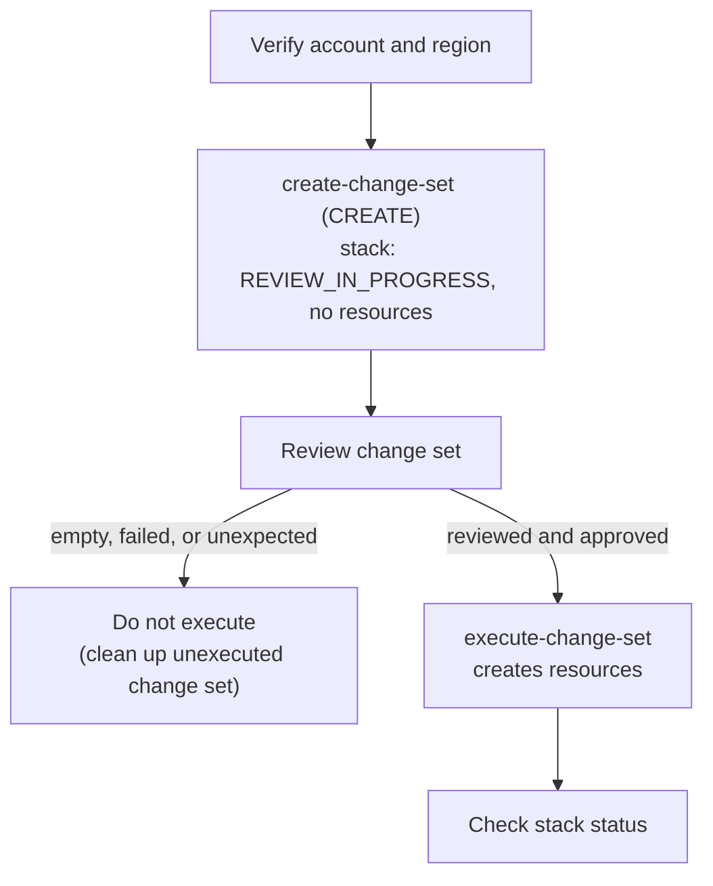

# CLOUDGUARD — Deployment Guide

> Practical instructions for setting up, running, testing, and safely evaluating CLOUDGUARD locally and in AWS.

| | |
|---|---|
| **Project** | CLOUDGUARD — Secure AWS Network Architect |
| **Scope** | Local development, read-only AWS inspection, optional CloudFormation lab deployment |
| **Audience** | Developers, reviewers, project evaluators |
| **Shell** | Windows PowerShell |
| **Related docs** | [Architecture](ARCHITECTURE.md) · [API Reference](API_REFERENCE.md) · [Security Model](SECURITY_MODEL.md) · [Project Overview](PROJECT_OVERVIEW.md) |

## Table of Contents

1. [Deployment Safety](#1-deployment-safety)
2. [Prerequisites](#2-prerequisites)
3. [Project Structure](#3-project-structure)
4. [Local Setup](#4-local-setup)
5. [Run the Backend](#5-run-the-backend)
6. [Run the Frontend](#6-run-the-frontend)
7. [Validate the Project](#7-validate-the-project)
8. [Configure AWS Access for Inspection](#8-configure-aws-access-for-inspection)
9. [Review the CloudFormation Template](#9-review-the-cloudformation-template)
10. [Optional AWS Lab Deployment](#10-optional-aws-lab-deployment)
11. [Cleanup and Cost Awareness](#11-cleanup-and-cost-awareness)
12. [Troubleshooting](#12-troubleshooting)
13. [Current Limitations](#13-current-limitations)

## 1. Deployment Safety

CLOUDGUARD has distinct local, inspection, and infrastructure-deployment workflows. Do not treat them as interchangeable.

| Workflow | What it does | Changes AWS resources? |
|---|---|---|
| Local network planning | Calculates IPv4 subnet allocations | No |
| Local security analysis | Evaluates supplied security-group rules | No |
| AWS VPC inspection | Uses EC2 `Describe` operations on selected networking resources | No, not through the inspection function |
| CloudFormation deployment | Creates the resources defined in the template | **Yes** |



> [!WARNING]
> Do not deploy to an AWS account until you have reviewed the template, selected the intended account and region, checked the proposed change set, and understood possible charges. A template file existing locally deploys nothing, and no stack or AWS resources exist unless you create them.

> [!CAUTION]
> Use a dedicated lab account or environment where possible. Never paste AWS access keys, secret keys, session tokens, or populated `.env` files into source control, issue trackers, or documentation.

## 2. Prerequisites

| Tool | Purpose |
|---|---|
| Windows PowerShell | Run the commands in this guide |
| Python 3.12 or a compatible supported version | Backend runtime |
| Node.js and npm | Frontend development and production build |
| Git | Version control |
| AWS CLI | Optional: verify AWS identity; validate/review/deploy the CloudFormation template |
| cfn-lint | Optional: lint the CloudFormation template |

The project has previously been tested with Python 3.12.2, Node.js 24.20.0, npm 11.19.0, and Git 2.52.0 on Windows. Your versions may differ. Docker is not required for the documented local Python/Vite workflow.

**Check installed tools:**

```powershell
python --version
node --version
npm --version
git --version
```

If you intend to use AWS:

```powershell
aws --version
```

`cfn-lint` is optional and may not be installed:

```powershell
if (Get-Command cfn-lint -ErrorAction SilentlyContinue) {
    cfn-lint --version
} else {
    Write-Host "cfn-lint is not installed."
}
```

## 3. Project Structure

```text
CLOUDGUARD/
├── backend/
│   ├── app/
│   │   ├── main.py
│   │   └── services/
│   ├── tests/
│   └── requirements.txt
├── docs/
│   ├── API_REFERENCE.md
│   ├── ARCHITECTURE.md
│   ├── DEPLOYMENT_GUIDE.md
│   ├── PROJECT_OVERVIEW.md
│   └── SECURITY_MODEL.md
├── frontend/
│   ├── src/
│   ├── package.json
│   └── vite.config.js
├── infrastructure/
│   └── cloudformation/
│       └── cloudguard-network.yaml
└── .gitignore
```

- `backend/` — Python API and service logic.
- `frontend/` — Vite application.
- `infrastructure/cloudformation/` — template defining an optional AWS networking lab.

## 4. Local Setup

### 4.1 Open the project directory

The examples use the existing Windows project path. Change it if your project is stored elsewhere.

```powershell
Set-Location "$HOME\Desktop\CLOUDGUARD"
```

### 4.2 Set up the backend environment

Create the virtual environment only if it does not already exist:

```powershell
Set-Location "$HOME\Desktop\CLOUDGUARD\backend"

if (-not (Test-Path ".\.venv")) {
    python -m venv .venv
}
```

Activate it:

```powershell
.\.venv\Scripts\Activate.ps1
```

If PowerShell blocks activation, invoke the virtual environment's Python directly:

```powershell
.\.venv\Scripts\python.exe --version
```

Install the declared dependencies:

```powershell
.\.venv\Scripts\python.exe -m pip install -r requirements.txt
```

`requirements.txt` is the dependency source of truth. If you intentionally update dependencies, test the application and review the resulting file changes.

### 4.3 Set up the frontend

In a second PowerShell terminal:

```powershell
Set-Location "$HOME\Desktop\CLOUDGUARD\frontend"
npm ci
```

`npm ci` installs from `package-lock.json`. It may replace the local `node_modules` directory but does not change AWS resources. Skip it if dependencies are already installed and a clean install is not needed.

## 5. Run the Backend

```powershell
Set-Location "$HOME\Desktop\CLOUDGUARD\backend"
.\.venv\Scripts\python.exe -m uvicorn app.main:app --reload --port 8001
```

Keep this terminal open while using the application. Stop the server with `Ctrl+C`.

> [!NOTE]
> Port `8001` is the documented development port; the Vite dev server is configured to forward `/api` requests to it (see [Architecture](ARCHITECTURE.md)). Uvicorn's own default is `8000`, which the frontend proxy would not reach. If `8001` is occupied, stop the process using it, or choose another port and update the frontend configuration to match.

Once running, interactive API documentation is available at [`http://127.0.0.1:8001/docs`](http://127.0.0.1:8001/docs) and the health check at `http://127.0.0.1:8001/health`. These are local development URLs only. Confirm the actual address in the running server's output.

## 6. Run the Frontend

In a separate PowerShell terminal:

```powershell
Set-Location "$HOME\Desktop\CLOUDGUARD\frontend"
npm run dev
```

Use the local URL printed by Vite; the documented development address is `http://127.0.0.1:5173/`, but do not assume it if Vite selects a different port. Stop with `Ctrl+C`.

<details>
<summary><strong>Frontend cannot reach the backend</strong></summary>

Check the actual frontend API configuration (`frontend/vite.config.js`), the backend bind address and port, and CORS settings. Do not invent or add environment-variable names without first verifying how this repository configures the API URL. For a non-default backend port, ensure the frontend is configured for that port before testing features.

</details>

## 7. Validate the Project

Run checks from the relevant directories.

### 7.1 Backend tests

```powershell
Set-Location "$HOME\Desktop\CLOUDGUARD\backend"
.\.venv\Scripts\python.exe -m pytest -q
```

A passing suite means the covered tests passed in that environment. It is not a guarantee of production security or complete functionality.

### 7.2 Frontend production build

```powershell
Set-Location "$HOME\Desktop\CLOUDGUARD\frontend"
npm run build
```

Vite normally writes generated assets to `frontend\dist`. This is build output, not source code; the project `.gitignore` excludes it.

### 7.3 CloudFormation template validation

This requires working AWS credentials (see [section 8](#8-configure-aws-access-for-inspection)). It sends the template to CloudFormation for syntax validation only; it creates no resources.

```powershell
Set-Location "$HOME\Desktop\CLOUDGUARD"
aws cloudformation validate-template `
    --template-body file://infrastructure/cloudformation/cloudguard-network.yaml `
    --region ap-south-1
```

If `cfn-lint` is installed:

```powershell
cfn-lint ".\infrastructure\cloudformation\cloudguard-network.yaml"
```

> [!NOTE]
> This command is a reproducible check; it succeeded in the maintainer's environment using the default AWS credentials. Validation does not guarantee the template is deployable in your account, nor that the design is secure. Do not report a check as passed unless you ran it and inspected the result.

## 8. Configure AWS Access for Inspection

AWS access is optional for local planning and local rule analysis. It is required for AWS inspection against a real account and for the AWS CLI commands in sections 7.3, 10, and 11.

### 8.1 Choose a credential approach

The AWS CLI uses the profile named `default` unless told otherwise. A named profile such as `cloudguard-lab` exists **only if you create it**; this guide does not assume it does.

| Approach | When to use | What to do |
|---|---|---|
| **A. Existing `default` profile** (recommended if it already points at your intended lab account) | You already have working default credentials | Nothing. Run the commands in this guide as written. Do not create duplicate credentials. |
| **B. Named profile `cloudguard-lab`** | You want CLOUDGUARD separated from your default credentials | Create it once, then select it for the session (see below). |

List the profiles that exist on your machine:

```powershell
aws configure list-profiles
```

Show what the CLI will actually use right now (profile, region, and where each value comes from; secrets are masked):

```powershell
aws configure list
```

**Approach B only** — create the named profile and select it for the current PowerShell session:

```powershell
aws configure --profile cloudguard-lab
$env:AWS_PROFILE = "cloudguard-lab"
```

Enter credentials only into the trusted AWS CLI prompt. Prefer temporary or role-based credentials where available; never embed long-lived credentials in code or commit them.

> [!NOTE]
> `$env:AWS_PROFILE` applies to the **current PowerShell session** and to processes launched from it, including the AWS CLI and the backend (Boto3). It is not written to project files, and a new terminal will not have it. Start the backend from the same session where it is set. Because it selects the profile for every command, the commands in this guide contain no `--profile` flag. To return to default credentials in this session: `Remove-Item Env:AWS_PROFILE`.

### 8.2 Verify identity and region before any AWS action

Run both checks and confirm the account and region are the ones you intend:

```powershell
aws sts get-caller-identity
aws configure get region
```

If either is not the intended target, stop and correct your configuration. The inspection function currently defaults to `ap-south-1` when no region is provided. To make the backend's region explicit for the current session:

```powershell
$env:AWS_DEFAULT_REGION = "ap-south-1"
```

This is also session-scoped. Identity and region checks are read-only and are not deployment commands.

### 8.3 Use least privilege

The inspected AWS service calls require these EC2 actions:

| Permission |
|---|
| `ec2:DescribeVpcs` |
| `ec2:DescribeSubnets` |
| `ec2:DescribeRouteTables` |
| `ec2:DescribeInternetGateways` |
| `ec2:DescribeSecurityGroups` |

Grant only what the intended inspection scope requires. The inspector's use of read-only `Describe` calls says nothing about how broad the configured identity's permissions are; the application does not verify that the identity is least-privileged. CloudFormation deployment needs different, broader permissions, and the read-only statement does **not** apply to it.

## 9. Review the CloudFormation Template

**Location:** `infrastructure/cloudformation/cloudguard-network.yaml`

| Item | Definition |
|---|---|
| Parameter | `EnvironmentName` (default `cloudguard-lab`) |
| VPC | One VPC using `10.0.0.0/16` |
| Subnets | Two public-designated, two private-designated |
| Internet Gateway | One, with attachment |
| Route tables | Separate public and private |
| Public route | Default IPv4 route to the Internet Gateway |
| Private route table | No default Internet route |
| Security group | No inbound rules; outbound TCP 443 to `0.0.0.0/0` |
| Not defined | Compute instances, NAT Gateways, automatic public IPv4 assignment |

> [!NOTE]
> The private route table having no default Internet route is a property of that route table, not a guarantee of isolation or of the reachability of any workload. Likewise, the public route and the absence of automatic public IPv4 assignment do not by themselves establish that anything is, or is not, reachable from the internet; that depends on the full network and workload configuration.

The security group allows outbound HTTPS to **any IPv4 destination**. Before deployment, review every resource, property, route, and expected cost.

## 10. Optional AWS Lab Deployment

> [!CAUTION]
> Executing the commands in this section **creates** AWS resources in the selected account and region. Proceed only with permission to use that account, after reviewing expected costs. These commands are documentation; nothing in this guide deploys automatically, and the template has not been deployed unless you do so.



### 10.1 Confirm the account and region

```powershell
aws sts get-caller-identity
aws configure get region
```

If the account or region is not the intended target, stop and correct your configuration (see [section 8](#8-configure-aws-access-for-inspection)).

### 10.2 Create a change set for review

This step does not create the lab's resources, but it does create a stack record in `REVIEW_IN_PROGRESS` state. Run from the repository root:

```powershell
Set-Location "$HOME\Desktop\CLOUDGUARD"

aws cloudformation create-change-set `
    --stack-name cloudguard-lab `
    --change-set-name initial-review `
    --change-set-type CREATE `
    --template-body file://infrastructure/cloudformation/cloudguard-network.yaml `
    --parameters ParameterKey=EnvironmentName,ParameterValue=cloudguard-lab `
    --region ap-south-1
```

`--parameters` is optional here because `EnvironmentName` already defaults to `cloudguard-lab`; it is shown to make the value explicit. The template declares no IAM resources, so an IAM capability acknowledgement is not expected for the current template; reassess if the template changes.

Wait for processing, then inspect:

```powershell
aws cloudformation wait change-set-create-complete `
    --stack-name cloudguard-lab `
    --change-set-name initial-review `
    --region ap-south-1

aws cloudformation describe-change-set `
    --stack-name cloudguard-lab `
    --change-set-name initial-review `
    --region ap-south-1
```

Review the full proposed changes. If the change set is empty, failed, or unexpected, do **not** execute it. A change-set review does not replace reviewing the template and account context.

<details>
<summary><strong>Stack states and name conflicts</strong></summary>

| Stack state | Meaning | Safe next step |
|---|---|---|
| *(does not exist)* | No stack with that name in this account/region | A `CREATE` change set is appropriate |
| `REVIEW_IN_PROGRESS` | A `CREATE` change set exists; no resources created yet | Review it, then execute or clean up |
| `CREATE_IN_PROGRESS` | Resources are being created | Wait; check status |
| `CREATE_COMPLETE` | Stack and resources exist | Do not run a `CREATE` change set again; see below |
| `ROLLBACK_COMPLETE` | Creation failed and was rolled back | Review stack events to find the cause before taking any action |

- **Stack already exists:** `create-change-set` with `--change-set-type CREATE` will fail for a stack name already in use. Do not switch to `UPDATE` or change the stack name without first reviewing what already exists in that account and region.
- **Change-set name already used:** change-set names must be unique within a stack. Choose a different `--change-set-name` rather than deleting anything, or confirm the old one is unexecuted and no longer needed (see [section 11](#11-cleanup-and-cost-awareness)).
- To see which stacks exist (read-only): `aws cloudformation describe-stacks --region ap-south-1` (returns an error if none match a given `--stack-name`).

</details>

### 10.3 Execute only after review

> [!WARNING]
> Executing the change set **creates AWS resources**. Run it only if you deliberately choose to create the lab, have reviewed the change set, and have confirmed the account, region, and costs.

```powershell
aws cloudformation execute-change-set `
    --stack-name cloudguard-lab `
    --change-set-name initial-review `
    --region ap-south-1
```

Check stack status rather than assuming success:

```powershell
aws cloudformation describe-stacks `
    --stack-name cloudguard-lab `
    --region ap-south-1
```

### 10.4 View stack outputs (existing stack only)

Run this **only after a stack named `cloudguard-lab` actually exists** (for example, after section 10.3). It is read-only. If no such stack exists, the command returns an error, which is expected.

```powershell
aws cloudformation describe-stacks `
    --stack-name cloudguard-lab `
    --query "Stacks[0].Outputs" `
    --output table `
    --region ap-south-1
```

## 11. Cleanup and Cost Awareness

AWS networking resources may incur charges depending on resources created, region, and current pricing. The template creates no NAT Gateway or compute instances, but check current AWS pricing and your billing information before deployment.

> [!WARNING]
> Deletion commands remove AWS resources or records. Before running any of them, confirm the account, region, and stack name, and that nothing required depends on them. Do not manually delete CloudFormation-managed resources unless you understand the resulting stack state.

### 11.1 Clean up an unexecuted change set

Applies when you created a change set (stack in `REVIEW_IN_PROGRESS`) but decided **not** to execute it. No lab resources exist in this case. First confirm the state:

```powershell
aws cloudformation describe-stacks `
    --stack-name cloudguard-lab `
    --region ap-south-1
```

Optionally remove just the change set:

```powershell
aws cloudformation delete-change-set `
    --stack-name cloudguard-lab `
    --change-set-name initial-review `
    --region ap-south-1
```

The empty stack record remains in `REVIEW_IN_PROGRESS`. If you no longer need it, remove it with the `delete-stack` command in 11.2, after confirming the stack contains no resources.

### 11.2 Delete a deployed stack

Applies only to a stack you executed and verified contains only resources you intend to remove:

```powershell
aws cloudformation delete-stack `
    --stack-name cloudguard-lab `
    --region ap-south-1

aws cloudformation wait stack-delete-complete `
    --stack-name cloudguard-lab `
    --region ap-south-1
```

You can also check with `aws cloudformation describe-stacks`; AWS may report that the stack no longer exists once deletion completes. If deletion fails or the stack enters a failed state, review stack events rather than deleting resources manually.

## 12. Troubleshooting

<details>
<summary><strong>Python or virtual environment command fails</strong></summary>

- Confirm Python is installed: `python --version`.
- Run commands from the `backend` directory.
- If the virtual environment is missing, create it: `python -m venv .venv`.
- Install dependencies: `.\.venv\Scripts\python.exe -m pip install -r requirements.txt`.
- If activation is blocked, call the virtual environment's Python executable directly.

</details>

<details>
<summary><strong>Frontend dependencies or build fail</strong></summary>

- Confirm Node.js and npm are installed.
- Run `npm ci` from the `frontend` directory.
- Read the first relevant error in the terminal rather than assuming the build output is the cause.
- Check that the source files and lockfile are present.

</details>

<details>
<summary><strong>AWS CLI says the profile could not be found</strong></summary>

- Run `aws configure list-profiles` to see which profiles exist.
- If `AWS_PROFILE` is set to `cloudguard-lab` but that profile was never created, either create it (`aws configure --profile cloudguard-lab`) or clear the variable: `Remove-Item Env:AWS_PROFILE`.
- Remember the variable is per-session; a new terminal starts without it.

</details>

<details>
<summary><strong>Backend cannot access AWS</strong></summary>

- Verify the identity with `aws sts get-caller-identity` in the **same terminal** that launches the backend.
- Check `aws configure list` for the effective profile and region.
- Confirm the identity has the required EC2 `Describe` permissions.
- Confirm network access to AWS endpoints.
- Never work around access-denied errors by switching to unrestricted administrator permissions.

</details>

<details>
<summary><strong>CloudFormation validation or change set fails</strong></summary>

- Review the exact AWS CLI error and stack events.
- Confirm the selected account and region.
- Validate the template before deployment.
- Check whether a stack or change set with the same name already exists (see [Stack states and name conflicts](#102-create-a-change-set-for-review)).
- Do not execute a failed, empty, or unexpected change set.

</details>

## 13. Current Limitations

- The AWS inspector evaluates selected VPC networking resources and security-group rules; it is not a complete AWS account audit.
- Findings are rule-based indicators and do not establish exploitability. No findings do not prove an environment is secure.
- Route-table classification does not prove end-to-end internet reachability.
- Network ACLs, IAM policies, firewall appliances, workload state, and application health are outside the inspected AWS analysis scope.
- Authentication, authorization, production hardening, and comprehensive monitoring must be verified separately.
- A successful local test suite, frontend build, or template validation does not certify production security or deployability.
- The CloudFormation template describes infrastructure; it does not deploy itself.

See also: [Architecture](ARCHITECTURE.md) · [API Reference](API_REFERENCE.md) · [Security Model](SECURITY_MODEL.md) · [Project Overview](PROJECT_OVERVIEW.md)

**Maintenance:** Update this guide when project commands, dependencies, AWS permissions, application configuration, or infrastructure resources change. Record validation results only after the relevant checks have actually been run.

[↑ Back to top](#cloudguard--deployment-guide)
