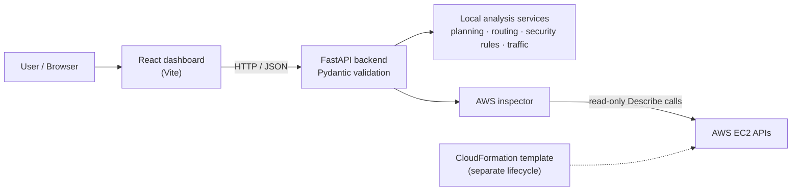

# CLOUDGUARD — Secure AWS Network Architect

> A security-focused AWS network architecture and analysis project: IPv4 network planning, simplified route and traffic analysis, rule-based security-group findings, and read-only AWS VPC discovery, presented in a React dashboard backed by FastAPI.

| | |
|---|---|
| **Type** | Cloud security and networking portfolio project |
| **Status** | Actively developed; not production-ready ([Project Status](#10-project-status)) |
| **Stack** | React · Vite · Python · FastAPI · Pydantic · Boto3 · AWS CloudFormation |
| **Docs** | [Architecture](ARCHITECTURE.md) · [API Reference](API_REFERENCE.md) · [Security Model](SECURITY_MODEL.md) · [Deployment Guide](DEPLOYMENT_GUIDE.md) |

> [!IMPORTANT]
> CLOUDGUARD's results are **rule-based indicators from simplified models**. They do not prove exploitability or end-to-end reachability, and an absence of findings does not prove an environment is secure.

## Table of Contents

1. [Project Overview](#1-project-overview)
2. [Problem Statement](#2-problem-statement)
3. [Project Objectives](#3-project-objectives)
4. [Core Features](#4-core-features)
   - [4.1 Network Planning](#41-network-planning)
   - [4.2 Route Evaluation](#42-route-evaluation)
   - [4.3 Security Group Analysis](#43-security-group-analysis)
   - [4.4 Traffic Simulation](#44-traffic-simulation)
   - [4.5 Read-Only AWS Discovery](#45-read-only-aws-discovery)
   - [4.6 Interactive Dashboard](#46-interactive-dashboard)
5. [Technology Stack](#5-technology-stack)
6. [High-Level Architecture](#6-high-level-architecture)
7. [Security Principles](#7-security-principles)
8. [Scope and Limitations](#8-scope-and-limitations)
9. [Intended Audience](#9-intended-audience)
10. [Project Status](#10-project-status)

## 1. Project Overview

CLOUDGUARD helps users understand network design, routing behaviour, security group exposure, and potential traffic-flow issues. A React dashboard talks to a Python FastAPI backend that provides network planning, simplified route evaluation, security rule analysis, traffic simulation, and read-only AWS VPC discovery.

The project emphasizes understandable findings, visual network inspection, and transparent explanations of what each analysis can and cannot establish.

## 2. Problem Statement

AWS networking involves several connected components: VPCs, subnets, route tables, internet gateways, and security groups. Understanding how they interact is difficult, especially when assessing exposure or diagnosing why a path does not behave as expected.

CLOUDGUARD brings selected planning and analysis capabilities into one interface so users can explore configurations, spot potentially risky security rules, and reason about simplified traffic paths.

## 3. Project Objectives

- Generate structured IPv4 subnet plans for a proposed VPC.
- Evaluate routes using simplified longest-prefix-match logic.
- Flag potentially risky security group rules through rule-based analysis.
- Simulate selected traffic paths using routes and security rules.
- Discover selected AWS VPC resources through read-only EC2 API operations.
- Present topology, subnet exposure indicators, and path-analysis details in a dashboard.
- Document analysis limitations explicitly.
- Maintain a testable, modular codebase suitable for further development.

## 4. Core Features

| Capability | Touches AWS? | API endpoint |
|---|---|---|
| [Network planning](#41-network-planning) | No | `POST /api/network/plan` |
| [Route evaluation](#42-route-evaluation) | No | `POST /api/network/route-check` |
| [Security group analysis](#43-security-group-analysis) | No | `POST /api/security/audit` |
| [Traffic simulation](#44-traffic-simulation) | No | `POST /api/traffic/simulate` |
| [Read-only AWS discovery](#45-read-only-aws-discovery) | Yes (EC2 `Describe`) | `GET /api/aws/discovery` |
| [Interactive dashboard](#46-interactive-dashboard) | Via the API | — |

Request and response details are in the [API Reference](API_REFERENCE.md).

### 4.1 Network Planning

Validates IPv4 CIDR ranges and calculates subnet allocations for requested public and private subnet groups. Output includes subnet CIDRs, address capacity, allocation counts, and remaining capacity.

The public/private labels describe the requested design. They do not establish whether a subnet is reachable from the internet.

### 4.2 Route Evaluation

Checks a destination IP against a VPC CIDR and a supplied set of routes. Destinations inside the VPC CIDR are treated as local. For external destinations, longest-prefix-match selects a route, and its target is evaluated under the application's simplified routing rules.

> [!NOTE]
> This is an educational routing model, not a complete reproduction of AWS route processing.

### 4.3 Security Group Analysis

Evaluates supplied IPv4 security rules and reports selected exposure patterns, such as:

- Inbound access from `0.0.0.0/0` across all protocols.
- Publicly accessible SSH or RDP ports.
- Public database ports such as MySQL and PostgreSQL.
- Broad inbound TCP or UDP port ranges.
- Unrestricted outbound access.

Findings carry severity levels and explanatory identifiers. Current rule codes and severities are listed in the [Security Model](SECURITY_MODEL.md#8-detection-rules-and-severity).

### 4.4 Traffic Simulation

Evaluates a proposed flow using supplied routing information and security rules. It checks the route, then the applicable outbound rule, then the applicable inbound rule, and returns an allow/block decision with explanatory details.

The simulator is intentionally simplified and does not model every AWS networking, firewall, application, or connection-state behaviour.

### 4.5 Read-Only AWS Discovery

Uses selected Amazon EC2 `Describe` operations to inspect a specified VPC and its associated networking resources. It requires valid AWS credentials, IAM permissions, and an existing VPC; permissions should be limited to the required `Describe` operations.

<strong>Discovery scope</strong>

- VPC information and tags.
- Subnets and their route associations.
- Route tables and routes.
- Internet gateway attachments.
- Security groups and their permissions.
- Selected rule-based security findings.

See the [Deployment Guide](DEPLOYMENT_GUIDE.md#8-configure-aws-access-for-inspection) and [Security Model](SECURITY_MODEL.md#5-aws-permissions-and-least-privilege).

### 4.6 Interactive Dashboard

The React dashboard presents network and security information interactively:

- Network topology exploration.
- Subnet selection and inspection.
- Route table and gateway target inspection.
- Subnet exposure indicators.
- Network path analysis across relevant topology components.

> [!NOTE]
> Dashboard indicators reflect the data available to the application and are not proof of end-to-end reachability.

## 5. Technology Stack

| Component | Technology |
|---|---|
| Frontend | React |
| Frontend tooling | Vite |
| Backend API | Python, FastAPI |
| API validation | Pydantic |
| AWS integration | Boto3, Amazon EC2 `Describe` APIs |
| Infrastructure definition | AWS CloudFormation |
| Backend testing | pytest |
| API documentation | FastAPI OpenAPI, Swagger UI |
| Development environment | Windows, PowerShell, Python virtual environment, Node.js and npm |

Dependency versions are intentionally not listed; check the project's dependency files.

## 6. High-Level Architecture

1. The user interacts with the React dashboard.
2. The frontend sends API requests to the FastAPI backend.
3. The backend validates input and invokes the relevant planning, routing, security, traffic, or AWS discovery service.
4. The service computes results or performs permitted read-only AWS discovery.
5. The backend returns structured results, which the dashboard presents.

The CloudFormation template separately defines the AWS networking lab; the application does not deploy it. Local analysis engines evaluate supplied data and do not query a live AWS environment. Full detail: [Architecture](ARCHITECTURE.md).

## 7. Security Principles

Intended design principles:

- Prefer read-only AWS discovery with least-privilege permissions.
- Avoid long-lived AWS access keys in application source code; use Boto3-supported credential providers.
- Validate user-supplied CIDRs, IP addresses, protocols, ports, and resource identifiers.
- Keep credentials, local environment files, and audit reports out of version control.
- Explain the limitations of automated findings.
- Require separate review and approval before making infrastructure changes.

> [!NOTE]
> These describe the intended operating model. Actual security depends on configuration, permissions, implementation, and deployment practices. See the [Security Model](SECURITY_MODEL.md).

## 8. Scope and Limitations

The current implementation focuses on selected IPv4 networking and security analysis.

- Network planning and traffic simulation use simplified models.
- The route evaluator does not reproduce every AWS routing behaviour.
- Security analysis does not establish exploitability or complete effective reachability.
- AWS discovery inspects selected EC2 networking resources, not the entire account.
- Full IPv6 analysis is not implemented. The live inspector recognizes `::/0` as a public source; the local analyzer does not model IPv6 rules.
- Network ACLs, workload health, application behaviour, and other network controls are not fully modeled.
- A private subnet classification does not, by itself, guarantee isolation.
- Findings require context and human review before operational decisions are made.

## 9. Intended Audience

- Cloud, infrastructure, and cybersecurity students and learners.
- AWS networking practitioners exploring network configurations.
- Developers building cloud security tooling portfolios.
- Reviewers evaluating networking, API development, testing, and security-analysis skills.

## 10. Project Status

CLOUDGUARD is an actively developed portfolio project. This document describes the intended scope and the implementation inventory reviewed during development.

<strong>Recommended before a public release</strong>

- [ ] Fresh test run (backend tests and frontend build).
- [ ] Dependency and secret checks.
- [ ] Infrastructure-template validation.
- [ ] Documentation review.
- [ ] Repository hygiene checks.

> [!WARNING]
> No claim of production readiness or comprehensive AWS security coverage is made.

[↑ Back to top](#cloudguard--secure-aws-network-architect)
