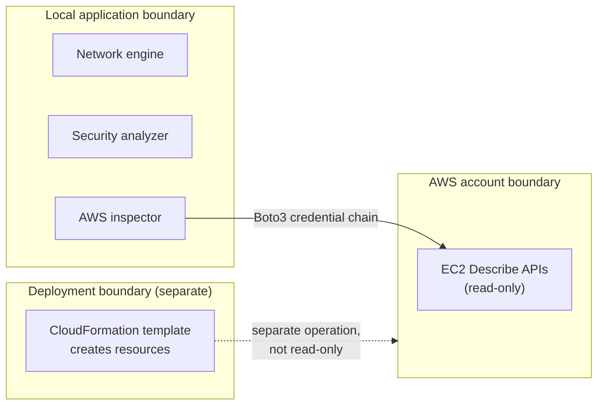
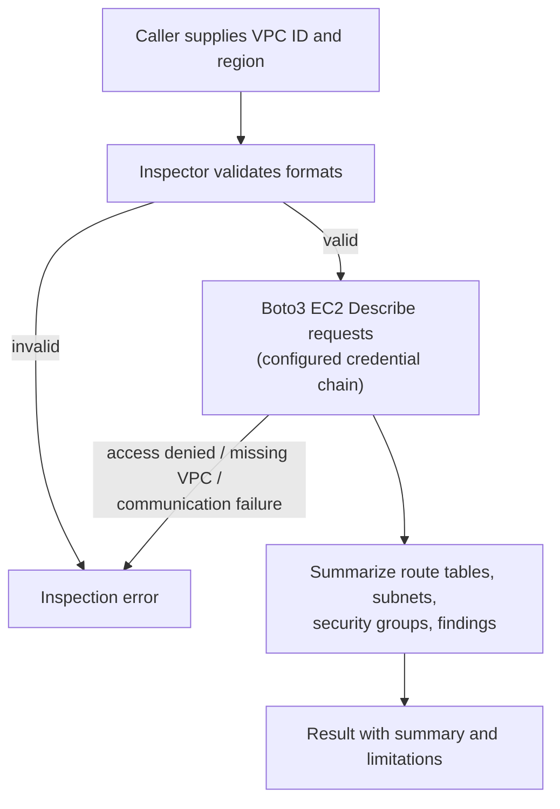

# CLOUDGUARD — Security Model

> Security boundaries, threat scenarios, detection rules, operational assumptions, and known limitations of the current CLOUDGUARD implementation.

| | |
|---|---|
| **Project** | CLOUDGUARD — Secure AWS Network Architect |
| **Status** | Based on the inspected implementation files. Not an independent security certification or penetration-test report. |
| **Related docs** | [Architecture](ARCHITECTURE.md) · [API Reference](API_REFERENCE.md) |
| **Inspected sources** | [`aws_inspector.py`](../backend/app/services/aws_inspector.py) · [`security_analyzer.py`](../backend/app/services/security_analyzer.py) · [`network_engine.py`](../backend/app/services/network_engine.py) · [`cloudguard-network.yaml`](../infrastructure/cloudformation/cloudguard-network.yaml) |

> [!IMPORTANT]
> Findings are **indicators, not proof of exploitability**. An absence of findings does **not** prove an environment is secure.

## Table of Contents

1. [Purpose and Scope](#1-purpose-and-scope)
2. [Security Objectives](#2-security-objectives)
3. [System Components and Trust Boundaries](#3-system-components-and-trust-boundaries)
   - [3.1 Local application boundary](#31-local-application-boundary)
   - [3.2 AWS account boundary](#32-aws-account-boundary)
   - [3.3 Infrastructure deployment boundary](#33-infrastructure-deployment-boundary)
   - [3.4 User and API boundary](#34-user-and-api-boundary)
4. [Data Flow](#4-data-flow)
5. [AWS Permissions and Least Privilege](#5-aws-permissions-and-least-privilege)
   - [5.1 Inspection permissions](#51-inspection-permissions)
   - [5.2 Credential handling](#52-credential-handling)
   - [5.3 Deployment permissions](#53-deployment-permissions)
6. [Network Security Design](#6-network-security-design)
   - [6.1 Subnet planning](#61-subnet-planning)
   - [6.2 CloudFormation lab topology](#62-cloudformation-lab-topology)
   - [6.3 Security-group baseline](#63-security-group-baseline)
7. [Threat Model](#7-threat-model)
8. [Detection Rules and Severity](#8-detection-rules-and-severity)
   - [8.1 Live AWS inspection findings](#81-live-aws-inspection-findings)
   - [8.2 Local rule-analyzer findings](#82-local-rule-analyzer-findings)
   - [8.3 Severity interpretation](#83-severity-interpretation)
   - [8.4 How to read findings](#84-how-to-read-findings)
9. [Input Validation and Error Handling](#9-input-validation-and-error-handling)
10. [Known Limitations](#10-known-limitations)
11. [Security Validation Plan](#11-security-validation-plan)
12. [Operational Safety Principles](#12-operational-safety-principles)
13. [Document Maintenance](#13-document-maintenance)

## 1. Purpose and Scope

CLOUDGUARD is a secure AWS network architecture and security-analysis project. It provides IPv4 network planning, security-group rule analysis, and read-only inspection of selected AWS VPC networking resources.

This document describes the security boundaries, threat scenarios, analysis rules, operational assumptions, and known limitations of the current implementation. It reflects the inspected source files listed above and does not claim that controls or capabilities exist unless they are demonstrated by these components.

**Four capabilities are kept distinct throughout this document:**

| Capability | Touches AWS? | Can create resources? |
|---|---|---|
| Read-only AWS inspection (EC2 `Describe` operations) | Yes | No |
| Local rule-based security-group analysis | No | No |
| IPv4 network/subnet planning | No | No |
| CloudFormation deployment | Yes | **Yes — not read-only** |

## 2. Security Objectives

1. **Read-only AWS inspection:** Inspect selected VPC resources without creating, modifying, or deleting resources through the inspection function.
2. **Network exposure identification:** Identify selected risky security-group rules and potential public routing configurations.
3. **Input validation:** Reject malformed VPC identifiers, region strings, CIDR networks, protocols, and port ranges handled by the inspected services.
4. **Network segmentation planning:** Produce separate public and private subnet allocations for IPv4 network plans.
5. **Restrictive lab infrastructure:** Define a CloudFormation lab network with no inbound security-group rules and HTTPS-only outbound security-group traffic.
6. **Transparent findings:** Return findings with severity, identifiers, descriptions, recommendations, and documented limitations where implemented.

> [!NOTE]
> These objectives describe the intended scope of the inspected components. They are not a certification that the entire application or a deployed AWS environment is secure.

## 3. System Components and Trust Boundaries

### 3.1 Local application boundary

The backend contains network-planning, security-analysis, and AWS-inspection services.

The network engine calculates subnet allocations locally. The security analyzer validates supplied security-group rules and evaluates them against implemented detection rules. These operations do not, by themselves, modify AWS infrastructure.

The security analyzer is a local rule analyzer, not a complete AWS account audit.

### 3.2 AWS account boundary

The AWS inspector uses Boto3 to request information about an existing VPC through EC2 `Describe` operations.

Inspected resource categories:

- VPC details
- Subnets
- Route tables
- Internet gateways attached to the VPC
- Security groups, including inbound and outbound rules

AWS credentials, permissions, network connectivity, and region selection form part of this boundary. The inspector handles AWS client errors and communication failures and returns user-safe inspection errors for recognized failure conditions.

### 3.3 Infrastructure deployment boundary

The CloudFormation template defines resources that AWS may create when a deployment is initiated: a VPC, an Internet Gateway and attachment, four subnets, public and private route tables, route associations, a default public route, and a restrictive security group.

> [!WARNING]
> Deploying this template is a separate operation from inspecting a VPC. The inspection function's read-only behavior must not be interpreted as meaning that CloudFormation deployment is read-only.

### 3.4 User and API boundary

The inspected service files do not establish the complete application's authentication, authorization, session-management, or API-access-control behavior. Those controls must be verified against the API routes, application entry point, middleware, and deployment configuration before security guarantees are documented.

## 4. Data Flow

**Read-only AWS inspection flow**

1. A caller supplies a VPC identifier and AWS region to the inspection function.
2. The inspector validates the identifier and region formats.
3. Boto3 submits EC2 `Describe` requests using the configured AWS credential chain.
4. AWS returns information about the requested VPC and its selected networking resources.
5. CLOUDGUARD summarizes route tables, subnets, security groups, and selected security findings.
6. The inspection result includes a summary and explicit limitations.

**Local security-analysis flow**

1. A caller supplies a security-group name and inbound and optional outbound rules.
2. The analyzer validates the protocol, CIDR, and applicable port fields.
3. The analyzer evaluates the rules against its implemented detection conditions.
4. Findings are ordered by severity and returned with recommendations.

**Network-planning flow:** validates an IPv4 VPC CIDR and requested subnet configuration, allocates subnet ranges, and returns the proposed plan. The plan itself does not create AWS resources.

## 5. AWS Permissions and Least Privilege

### 5.1 Inspection permissions

The inspected AWS service calls use these EC2 operations:

| Permission |
|---|
| `ec2:DescribeVpcs` |
| `ec2:DescribeSubnets` |
| `ec2:DescribeRouteTables` |
| `ec2:DescribeInternetGateways` |
| `ec2:DescribeSecurityGroups` |

The AWS identity used for inspection should have only the permissions needed for the intended inspection scope. Resource-level and region restrictions should be applied where supported and appropriate.

The application code does not create, change, or delete AWS resources during `inspect_vpc`. The configured credential chain and effective IAM permissions are external dependencies; the code does not itself prove that the configured identity has been restricted to these permissions.

### 5.2 Credential handling

- Supply credentials through an approved AWS credential mechanism, such as an appropriately configured AWS CLI profile, environment-based credential configuration, or an authorized role.
- Do not commit access keys, secret keys, session tokens, or populated environment files to source control.
- Prefer temporary credentials and role-based access where available. Never embed long-lived credentials in source code or documentation.

> [!NOTE]
> Credential storage, rotation, session duration, and deployment identity controls must be verified separately; they are not established by the inspected service files.

### 5.3 Deployment permissions

CloudFormation deployment requires permissions to create the resources declared in the template. Those deployment permissions are distinct from the read-only inspection permissions.

Review the deployment identity and proposed resource changes before deployment. Do not use broad administrative permissions merely for convenience. No AWS deployment should be assumed to have occurred solely because the template exists locally.

## 6. Network Security Design

### 6.1 Subnet planning

The network engine supports IPv4 CIDR validation and subnet allocation. It validates the VPC prefix, subnet prefix, requested subnet counts, and available subnet capacity. It labels planned subnets as public or private for planning purposes.

A subnet label is not a security boundary. Actual connectivity depends on route tables, gateways, addressing, security groups, network ACLs, and other applicable controls.

### 6.2 CloudFormation lab topology

| Component | Definition in current template |
|---|---|
| VPC | One VPC using `10.0.0.0/16` |
| Subnets | Two public-designated, two private-designated |
| Internet Gateway | One, attached to the VPC |
| Public route table | Default IPv4 route to the Internet Gateway |
| Private route table | Separate; no default Internet route |
| Associations | Explicit, subnets to their respective route tables |
| Security group | No inbound rules; outbound TCP port 443 to `0.0.0.0/0` |

The template sets `MapPublicIpOnLaunch` to `false` for all four subnets. It does not define compute instances, NAT Gateways, or automatically assigned public IPv4 addresses.

> [!NOTE]
> The public route table makes the associated subnets public-route candidates, but this does not alone establish that a workload is reachable from the internet. Addressing, security-group rules, workload configuration, and other controls also affect reachability. The private route table's lack of a default Internet route is a configuration property of that route table, not a general guarantee about every possible connectivity path.

### 6.3 Security-group baseline

The template defines an empty ingress rule list and allows outbound TCP traffic on port 443 to `0.0.0.0/0`.

This is a restrictive baseline compared with unrestricted inbound access. However, outbound HTTPS access is still permitted to any IPv4 destination under that rule. A security group is stateful, and this template does not define all other controls that might exist in a deployed environment. Effective security depends on the full network and workload configuration.

## 7. Threat Model

| Threat scenario | Potential impact | Control or detection | Residual limitation |
|---|---|---|---|
| Public SSH or RDP exposure | Increased brute-force and exploitation risk | Detect selected public ingress rules for ports 22 and 3389 | Does not prove a host exists or is reachable |
| Public database exposure | Unauthorized connection attempts against database services | Detect selected public database ports | Does not inspect database configuration or application authentication |
| Unrestricted inbound traffic | Excessive network exposure | Detect all-protocol or broad TCP/UDP ingress conditions | Other network controls and actual reachability not fully evaluated |
| Unrestricted outbound access | Increased potential for unwanted external connections | Detect selected unrestricted egress conditions | Does not analyze traffic behavior or destination reputation |
| Incorrect subnet assumptions | Accidental exposure from relying on subnet names | Return route-based classifications and planning notes | Does not establish end-to-end reachability |
| Invalid input | Incorrect analysis or failed requests | Validate supported IDs, CIDRs, protocols, and port ranges | Limited to fields and formats implemented by each service |
| Excessive AWS permissions | Greater impact if credentials are misused | Recommend least-privilege inspection identities | Effective IAM policy not validated by the inspected code |
| Credential exposure | Unauthorized AWS access | Recommend approved credential mechanisms and exclusion from source control | Repository hygiene does not prove credentials are absent everywhere |
| Incomplete security visibility | Misleading confidence in a clean result | Return explicit inspection limitations | Unsupported resources and controls may still introduce risk |

## 8. Detection Rules and Severity

### 8.1 Live AWS inspection findings

The AWS inspector currently evaluates selected security-group conditions.

| Finding code | Condition | Severity |
|---|---|---|
| `PUBLIC_ALL_PROTOCOLS` | Public IPv4 or IPv6 source permits all inbound protocols | `HIGH` |
| `PUBLIC_REMOTE_ADMIN` | Public source permits SSH or RDP ports | `HIGH` |
| `PUBLIC_DATABASE_PORT` | Public source permits selected common database ports | `HIGH` |
| `PUBLIC_INGRESS` | Other inbound rules permit a public source | `MEDIUM` |
| `UNRESTRICTED_EGRESS` | All outbound protocols permitted to a public IPv4 or IPv6 destination | `MEDIUM` |

The inspector recognizes public source CIDRs `0.0.0.0/0` and `::/0`. The exact detection conditions are defined in [`aws_inspector.py`](../backend/app/services/aws_inspector.py).

### 8.2 Local rule-analyzer findings

The local security analyzer implements a separate set of rules ([`security_analyzer.py`](../backend/app/services/security_analyzer.py)).

| Finding code | Condition | Severity |
|---|---|---|
| `INGRESS_ALL_TRAFFIC_PUBLIC` | Unrestricted IPv4 inbound rule permits all protocols | `CRITICAL` |
| `INGRESS_ALL_PORTS_PUBLIC` | Unrestricted IPv4 inbound TCP/UDP rule covers all ports | `CRITICAL` |
| `PUBLIC_SSH` | Unrestricted IPv4 TCP rule includes port 22 | `HIGH` |
| `PUBLIC_RDP` | Unrestricted IPv4 TCP rule includes port 3389 | `HIGH` |
| `PUBLIC_DATABASE_PORT` | Unrestricted IPv4 TCP rule includes port 3306 or 5432 | `CRITICAL` |
| `UNRESTRICTED_EGRESS` | Unrestricted IPv4 outbound rule supplied to the analyzer | `MEDIUM` |

The analyzer orders findings as `CRITICAL`, `HIGH`, `MEDIUM`, then `LOW`. Its aggregate risk level reflects the highest severity it finds.

### 8.3 Severity interpretation

Severity labels indicate the rule-based risk classification assigned by the implemented logic. They are not proof of exploitation, a confirmed incident, or a comprehensive business-impact assessment.

> [!WARNING]
> The live inspector and local analyzer use different rules and severity assignments (for example, `PUBLIC_DATABASE_PORT` is `HIGH` in the inspector but `CRITICAL` in the analyzer). Do not treat their results as equivalent without reviewing their respective logic.

The absence of findings means only that the implemented rules did not report a matching condition in the analyzed inputs. It does not establish that the environment is secure.

### 8.4 How to read findings

1. **Identify the source:** live inspector (8.1) or local analyzer (8.2); severities are not directly comparable.
2. **Read the code and condition:** a finding names a specific rule condition, not a confirmed vulnerability.
3. **Check context:** verify routing, addressing, network ACLs, workload state, and other controls the tools do not evaluate (see [Known Limitations](#10-known-limitations)).
4. **Prioritize for investigation:** treat severity as a triage order, not a measure of impact.
5. **Do not infer safety from silence:** no findings means only that no implemented rule matched.

## 9. Input Validation and Error Handling

<strong>Validation checks implemented in the inspected components</strong>

- VPC IDs are checked against the expected `vpc-` hexadecimal identifier pattern.
- AWS region strings are checked against a region-like format.
- VPC and subnet CIDRs are parsed and validated.
- The network planner accepts IPv4 networks and validates supported prefix lengths and subnet counts.
- The local rule analyzer validates protocol names, CIDR networks, and TCP/UDP port ranges.
- Expected AWS access failures, missing VPCs, and communication errors are converted to inspection errors.

> [!NOTE]
> These checks reduce errors caused by malformed input. They do not replace authentication, authorization, request-size limits, rate limiting, output encoding, or other application-layer security controls.

## 10. Known Limitations

The current inspection and analysis logic does not provide a complete AWS security assessment.

1. Network ACL rules are not evaluated.
2. IAM policies and effective permissions are not analyzed by the VPC inspection function.
3. Firewall appliances, workload state, and application health are not evaluated.
4. Route-table classification does not prove internet reachability.
5. The local analyzer does not inspect an AWS account.
6. The local analyzer does not model IPv6 rules, prefix lists, or security-group references.
7. Findings are rule-based indicators and require human review.
8. The inspected files do not establish end-to-end API authentication or authorization.
9. The inspected files do not establish complete logging, monitoring, audit retention, or incident-response controls.
10. The inspected files do not establish comprehensive secret scanning or credential lifecycle management.
11. The subnet planner creates a plan only; it does not validate the resulting topology against every AWS networking constraint or deployed resource.
12. A successful build or passing unit tests does not prove that the application is secure in production.

These limitations should be considered when interpreting findings and presenting project capabilities.

## 11. Security Validation Plan

> [!NOTE]
> These are **recommended** activities. A recommended test is not evidence that it has been performed; record validation results separately.

<strong>Recommended validation activities</strong>

- Run the backend test suite after changes to inspection or analysis logic.
- Test valid and invalid VPC IDs, regions, CIDRs, protocols, and port ranges.
- Test each supported detection rule, including boundary port values and public IPv4/IPv6 sources where applicable.
- Use mocked AWS responses to test missing resources, denied permissions, and service errors without requiring infrastructure changes.
- Validate the CloudFormation template with an appropriate linter and review its change set before any deployment.
- Verify the effective IAM permissions of the inspection identity.
- Review API authentication, authorization, input handling, and error responses in the full application.
- Check repository changes for accidentally included credentials and generated artifacts.
- Conduct deployment-specific reachability checks before treating any subnet or workload as isolated.

## 12. Operational Safety Principles

<strong>Principles (10)</strong>

1. Use read-only AWS permissions for inspection wherever possible.
2. Keep inspection credentials separate from infrastructure deployment credentials.
3. Review CloudFormation changes before creating or updating resources.
4. Do not expose management or database ports publicly unless explicitly justified and appropriately controlled.
5. Restrict network access to documented business requirements.
6. Keep credentials and local environment files out of source control.
7. Treat findings as investigation priorities, not automatic proof of a vulnerability.
8. Document exceptions and residual risks rather than silently suppressing them.
9. Verify deployed behavior instead of relying solely on planned configuration.
10. Do not describe unimplemented security controls as operational capabilities.

## 13. Document Maintenance

Update this document when the AWS inspector, security analyzer, network planner, CloudFormation template, or application security boundaries change.

For each significant security feature, record the relevant implementation, test coverage, assumptions, and known limitations.

**Document status:** Based on the inspected implementation files. This is a project security model, not an independent security certification or penetration-test report.

[↑ Back to top](#cloudguard--security-model)
